<!-- ═══════════════════════════ HERO ═══════════════════════════ -->

<div align="center">



<br />

<a href="https://www.linkedin.com/in/alrhaden-javier-86b89428b/">
  
</a>

</div>

<br />

## About Me

Hey, I'm **Raden**, a full-stack and systems developer. I like the whole stack: designing the schema, wiring the API, and then making the interface feel effortless.

I care about software that is *correct* before it is clever, well-tested, documented, and genuinely usable by the people who run it every day.

- **Building:**
  - [**CoE-NNECT**](https://github.com/RADENzzz/coe-nnect), a scheduling platform for the College of Engineering at WMSU.
  - [**End of The DayZ**](https://github.com/RADENzzz/End-of-the-Day), a 2D platform game, made with MONOGAME
  - [**CAPSLOCK**] A 3D Mini-Open world story ISEKAI game, made with GODOT 
- **Exploring:** systems programming, distributed web architecture, and game development.
- **2027 goal:** ship **CAPSLOCK**, my biggest game project yet.
- **Outside the terminal:** game engines, 3D art, and hardware tinkering on Raspberry Pi and Arduino.

<br />

## Featured Project

<h3 align="center">CoE-NNECT</h3>
<p align="center"><i>Academic scheduling for the College of Engineering · Western Mindanao State University</i></p>

<div align="center">

[](https://coe-nnectfrontend-production.up.railway.app/)
[](https://github.com/RADENzzz/coe-nnect)
[](https://github.com/RADENzzz/coe-nnect/blob/main/LICENSE)

</div>

Most universities still build faculty timetables by hand, moving blocks around a spreadsheet until nothing overlaps. **CoE-NNECT** replaces that with a real system: a monorepo web platform that validates schedules against **27 scheduling rules**, runs role-based review and approval workflows, and generates conflict-free timetables with a **constraint-programming solver**.

**What it does**

- Manages departments, terms, faculty, rooms, subjects, sections, and prospectuses.
- Creates, validates, reviews, approves, and publishes class schedules end to end.
- Enforces constraints for conflicts, faculty qualifications, teaching loads, and room suitability.
- Gives deans, department heads, and administrators dedicated role-based workspaces.
- Imports prospectus data straight from PDFs using editor-defined regions.
- Ships timetables, reports, audit history, notifications, and in-app chat.

**How it's built**

```text
React + Vite  ──►  NestJS API  ──►  Supabase (PostgreSQL + Auth)
                       │
                       ├──►  TypeScript rules engine (27 constraints)
                       ├──►  Python OR-Tools solver (CP-SAT)
                       └──►  FastAPI prospectus parser (PDF → data)
```

| Snapshot | Details |
| :-- | :-- |
| **Scope** | 78 / 79 functional requirements delivered (~99%) |
| **Correctness** | 27 constraint rules · 190 passing tests |
| **Architecture** | pnpm monorepo · 7 workspaces · shared rules package |
| **CI/CD** | 4 GitHub Actions pipelines · Playwright end-to-end suite |
| **Deployment** | Railway (API + Python services) · Vercel (frontend) |

**Stack:** `TypeScript` · `NestJS` · `React` · `Tailwind CSS` · `React Query` · `Zustand` · `Python` · `OR-Tools` · `PostgreSQL` · `Supabase` · `Docker` · `GitHub Actions`

<details>
<summary><b>Watch the auto-scheduler generate a timetable</b></summary>

<br />

<p align="center">
  
</p>

</details>

<br />

## Tech Stack

<table align="center">
  <tr>
    <td align="right"><b>Languages</b></td>
    <td>
      
    </td>
  </tr>
  <tr>
    <td align="right"><b>Frontend</b></td>
    <td>
      
    </td>
  </tr>
  <tr>
    <td align="right"><b>Backend &amp; Data</b></td>
    <td>
      
    </td>
  </tr>
  <tr>
    <td align="right"><b>Systems &amp; Creative</b></td>
    <td>
      
    </td>
  </tr>
  <tr>
    <td align="right"><b>Tooling</b></td>
    <td>
      
    </td>
  </tr>
</table>

<br />

## GitHub Stats

<div align="center">


<br />


</div>

<br />

## Contribution Graph

<div align="center">
  <picture>
    <source media="(prefers-color-scheme: dark)" srcset="https://raw.githubusercontent.com/RADENzzz/RADENzzz/output/github-contribution-grid-snake-dark.svg" />
    <source media="(prefers-color-scheme: light)" srcset="https://raw.githubusercontent.com/RADENzzz/RADENzzz/output/github-contribution-grid-snake.svg" />
    
  </picture>
</div>

<br />

## Let's Connect

<div align="center">

<a href="https://www.linkedin.com/in/alrhaden-javier-86b89428b/">
  
</a>
<a href="https://www.facebook.com/Alrhaden.Javier">
  
</a>
<a href="https://www.youtube.com/@AlrhadenJavier">
  
</a>
<a href="https://github.com/RADENzzz?tab=repositories">
  
</a>

<br /><br />

<i>Always up for a good build | let's make something worth shipping.</i>

</div>

<br />


