# Alrhaden Javier

Full-stack and systems developer. I work across the stack: schema design, API implementation, and the interface that ties it together.

I prioritize software that is correct before it is clever, well tested, documented, and usable by the people who operate it daily.

## Focus Areas

- Building CoE-NNECT, a scheduling platform for the College of Engineering at Western Mindanao State University.
- Developing CAPSLOCK, a 3D open-world narrative game built with Godot.
- Exploring systems programming, distributed web architecture, and game development.
- Current goal: release CAPSLOCK in 2027.
- Outside of work: game engines, 3D art, and hardware projects on Raspberry Pi and Arduino.

## Featured Project

### CoE-NNECT

Academic scheduling for the College of Engineering, Western Mindanao State University.
Live application: https://coe-nnectfrontend-production.up.railway.app/
Source: https://github.com/RADENzzz/coe-nnect
License: MIT

Faculty timetables are still commonly assembled by hand, moving blocks across a spreadsheet until nothing conflicts. CoE-NNECT replaces that process with a monorepo web platform that validates schedules against 27 scheduling rules, runs role-based review and approval workflows, and generates conflict-free timetables using a constraint-programming solver.

Capabilities

- Manages departments, terms, faculty, rooms, subjects, sections, and prospectuses.
- Supports the full lifecycle of a schedule: creation, validation, review, approval, and publication.
- Enforces constraints for conflicts, faculty qualifications, teaching loads, and room suitability.
- Provides dedicated role-based workspaces for deans, department heads, and administrators.
- Imports prospectus data from PDFs using editor-defined regions.
- Includes timetables, reports, audit history, notifications, and in-app messaging.

Architecture

    React + Vite  ->  NestJS API  ->  Supabase (PostgreSQL + Auth)
                          |
                          +->  TypeScript rules engine (27 constraints)
                          +->  Python OR-Tools solver (CP-SAT)
                          +->  FastAPI prospectus parser (PDF to data)

Project Status

- Scope: 78 of 79 functional requirements delivered (approximately 99%).
- Correctness: 27 constraint rules, 190 passing tests.
- Architecture: pnpm monorepo, 7 workspaces, shared rules package.
- CI/CD: 4 GitHub Actions pipelines, Playwright end-to-end suite.
- Deployment: Railway (API and Python services), Vercel (frontend).

Stack: TypeScript, NestJS, React, Tailwind CSS, React Query, Zustand, Python, OR-Tools, PostgreSQL, Supabase, Docker, GitHub Actions.

## Technical Skills

Languages        TypeScript, Python, Go, Rust, C++, C#, Swift
Frontend         React, Next.js, Tailwind CSS, Flutter
Backend & Data   Node.js, NestJS, Express, PostgreSQL, Supabase
Systems & Tools  Godot, Blender, Raspberry Pi, Arduino
Tooling          Git, GitHub Actions, Docker, Vite, Vercel

## Contact

LinkedIn   https://www.linkedin.com/in/alrhaden-javier-86b89428b/
GitHub     https://github.com/RADENzzz
YouTube    https://www.youtube.com/@AlrhadenJavier
